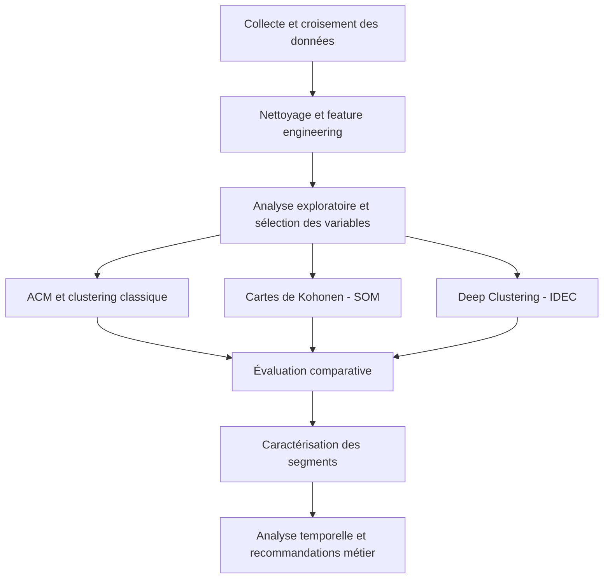

# Segmentation des assurés d’un portefeuille santé et prévoyance

**Machine Learning non supervisé · Deep Clustering · Analyse statistique · Prévention des risques**

> Thèse professionnelle — Mastère Spécialisé Science des données pour la Connaissance Client, ENSAI (2025–2026), réalisée en alternance chez IPECA.

## 1. Contexte et problématique

Dans le secteur de l’assurance santé et prévoyance, la connaissance des assurés constitue un levier stratégique pour le pilotage de la sinistralité et la personnalisation des dispositifs de prévention.

Ce projet vise à construire une segmentation statistique des assurés en croisant leurs caractéristiques sociodémographiques, leurs comportements de consommation de soins et leurs comportements en matière d’arrêt de travail.

**Problématique :** dans quelle mesure la segmentation statistique des assurés permet-elle à l’IPECA de rationaliser la connaissance de son portefeuille pour piloter une stratégie de prévention personnalisée ?

## 2. Objectifs

- Identifier des groupes homogènes d’assurés par apprentissage non supervisé.
- Comparer des méthodes classiques de clustering et des approches non linéaires de représentation des données.
- Caractériser les profils selon les consommations de soins et les formes d’arrêt de travail.
- Étudier les transitions entre segments et proposer des actions de prévention adaptées.

## 3. Données et préparation

L’étude repose sur le croisement de trois sources de données à la maille assuré, principalement sur l’année 2025 :

| Source | Variables étudiées |
| --- | --- |
| Effectifs | Âge, sexe, catégorie socioprofessionnelle, établissement, exposition |
| Prestations santé | Fréquence de recours, nombre de soins et coûts moyens |
| DSN – Arrêts de travail | Nombre d’arrêts, dates et durées |

La préparation comprend le nettoyage des données, l’agrégation des prestations par famille de soins, l’imputation des valeurs manquantes, la construction d’indicateurs annuels et la sélection des variables selon des critères statistiques et métier.

Les transformations mobilisées comprennent la discrétisation, la transformation de Yeo-Johnson et la mise à l’échelle robuste (RobustScaler). Une attention particulière est portée aux distributions asymétriques, à la redondance des variables et à la forte proportion de valeurs nulles.

## 4. Méthodologie

### Approches expérimentées

| Approche | Méthodes |
| --- | --- |
| Analyse factorielle et clustering | Analyse des correspondances multiples (ACM), K-means, Gaussian Mixture Models (GMM), DBSCAN |
| Apprentissage non supervisé neuronal | Cartes auto-organisatrices de Kohonen (Self-Organizing Maps, SOM) |
| Deep Learning | Improved Deep Embedded Clustering (IDEC), autoencodeur et K-means |

Les modèles sont évalués à l’aide du score de silhouette, des indices de Calinski-Harabasz et de Davies-Bouldin ainsi que de critères spécifiques : AIC, BIC, erreurs de quantification et topographique, et Adjusted Rand Index (ARI).

## 5. Modèle retenu : IDEC

L’approche IDEC apprend conjointement une représentation latente non linéaire et une partition des observations, tout en préservant l’information utile à la reconstruction des données.

Le pipeline comprend :

1. Pré-entraînement d’un autoencodeur (architecture 32–16–8–5–8–16–32).
2. Initialisation des clusters par K-means dans l’espace latent.
3. Optimisation conjointe de la divergence de Kullback-Leibler et de la perte de reconstruction.
4. Extraction d’un espace latent optimisé à cinq dimensions.
5. Application finale de K-means.

La fonction de perte de reconstruction utilise une MAE pondérée. La calibration intègre également une pondération des blocs de variables et une régularisation L2.

## 6. Principaux résultats

L’approche IDEC est retenue à l’issue de la comparaison des méthodes. Elle permet de construire une typologie finale composée de **six profils**, répartis entre les assurés avec et sans arrêt de travail.

| Population | Profils identifiés |
| --- | --- |
| Avec arrêt | Arrêts ponctuels à faible recours ; arrêts longs et forte consommation à dominance TMS ; arrêts plus fréquents à recours courant modéré |
| Sans arrêt | Faibles consommateurs ; polyconsommateurs plus âgés ; recours spécialisé TMS |

*TMS : troubles musculosquelettiques.*

L’étude des transitions entre 2024 et 2025 met également en évidence l’intérêt d’une actualisation régulière de la segmentation.

## 7. Applications métier

- Ciblage des actions de prévention primaire et secondaire.
- Prévention des troubles musculosquelettiques et amélioration de l’ergonomie.
- Prévention des récidives et accompagnement du retour au travail.
- Coordination des actions de prévention et pilotage du portefeuille.

## 8. Limites et perspectives

La segmentation est descriptive : elle ne démontre pas de relation causale et ne constitue pas un modèle de prédiction individuelle des arrêts de travail. Les conditions de travail, la santé perçue et l’usage réel des dispositifs de prévention ne sont pas observés dans cette étude.

Les perspectives comprennent l’actualisation régulière des segments, l’affinement du modèle IDEC et l’analyse à la maille établissement.

## 9. Confidentialité et reproductibilité

Les données individuelles de santé et de prévoyance ainsi que les informations internes de l’entreprise ne doivent pas être diffusées publiquement sans autorisation appropriée. La reproduction exacte des résultats nécessite l’accès aux données sources et aux traitements correspondants.

## 10. Auteur

**Deogratias ALLAKONON**  
Mastère Spécialisé Science des données pour la Connaissance Client — ENSAI  
Thèse professionnelle réalisée chez IPECA — 2025–2026

**Mots-clés :** Data Science, Unsupervised Learning, Customer Segmentation, Deep Learning, IDEC, SOM, K-means, GMM, DBSCAN, Feature Engineering, Health Insurance, Risk Prevention.
